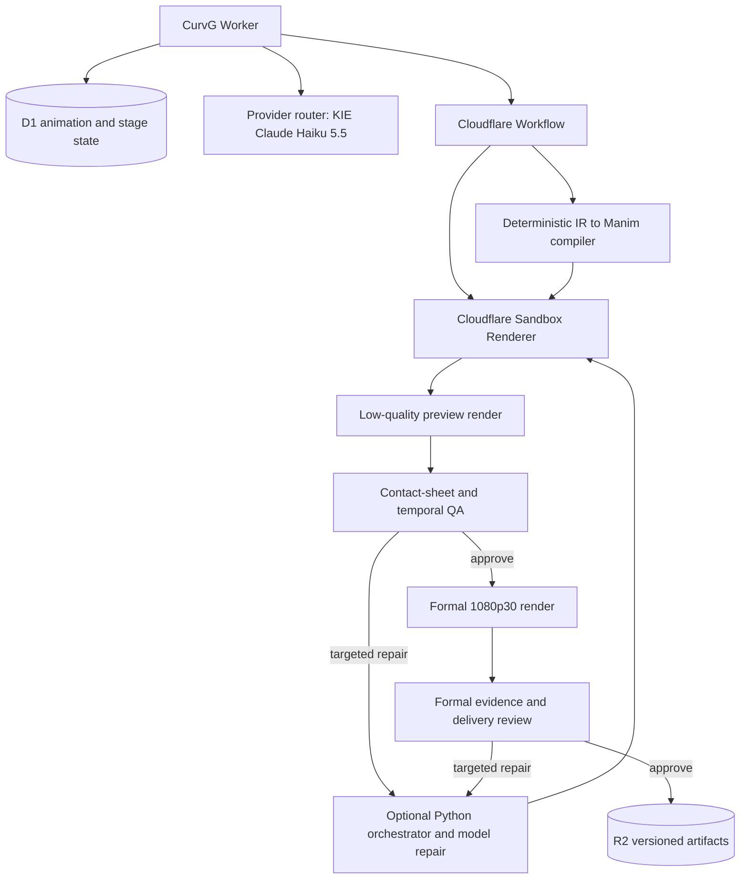

# CurvG Animation Orchestration

## Runtime architecture



The Worker remains the owner of authentication, subscriptions, credits,
provider credentials, model selection, D1 state, and renderer callbacks. The
initial render is compiled from the approved specification inside the Worker.
The optional Python service is used for visual-contract preflight and targeted
repair, not as a prerequisite for the first render.

## Production modes

New animation requests select an explicit production mode. Archived rows that
do not carry the field are interpreted as `explainer`.

| Mode               | Source of truth                                               | Initial code path                        |
| ------------------ | ------------------------------------------------------------- | ---------------------------------------- |
| `explainer`        | User request → six validated schema-v6 planning artifacts     | Deterministic IR compiler                |
| `simulation_short` | Server-owned scenario → fixed-step solver → canonical run log | Trusted event/checkpoint replay compiler |

The first `simulation_short` family is `ring_escape`. The public API does not
accept seed, solver configuration, or arbitrary physics parameters; it creates
the audited server-side scenario. `ring_escape/v1` runs twice before approval,
and the complete results must be byte-identical. Production stops unless the
event log ends in exactly one `terminal:escaped` state.

The renderer receives immutable, digest-bound artifacts with the trusted Manim
source:

- `events.jsonl` — contiguous canonical events, including contact enter/exit,
  escape, and terminal events.
- `state-track.json` — checkpoint positions and event cursors consumed by the
  visual replay subscriber.
- `run-manifest.json` — scenario, event-log, checkpoint, summary, and aggregate
  SHA-256 digests, including the trusted source and audio-plan digests. It is
  uploaded last as the R2 commit marker.
- `audio-plan.json` — the canonical event-SFX plan. It is not a user-supplied
  soundtrack and is verified against the run manifest before rendering.

The renderer independently parses the event, checkpoint, manifest, and audio
artifacts; recomputes their digests; and requires an escaped terminal state.
The exact replay-frame map drives both the visual replay and event SFX, so a
cue remains attached to its canonical event rather than an approximate wall
clock. Simulation render jobs have a zero model-repair budget: a model may
review composition, but it cannot rewrite physical state, event timing,
counts, audio timing, or the trusted replay source. A failure must be addressed
in the scenario or deterministic compiler and then run again.

Current scope is deliberately narrow: one vertical `ring_escape` scene at
1080x1920, 30 fps. Its formal delivery contains AAC at 48 kHz stereo generated
from the canonical event-SFX plan; preview output and `explainer` renders have
no audio track. There is no narration, music, publishing package, reference
video dissection, additional scenario family, or native 60 fps support. None
of those capabilities is implied by the `simulation_short` label.

Renderer protocol `curvg-renderer/v2` binds each new job to an approved frame
and duration, validates the formal 1080x1920/30-fps simulation MP4, and
requires a separate `delivery_review` before completion. That review combines
visual QA, media probing, simulation audio QA, and source/run/video digest
lineage. Submission identity is a stable SHA-256 of the animation, exact source,
frame, duration, and production mode, so a timed-out HTTP dispatch retry resolves
to the same renderer job instead of creating a duplicate queue item. Only the
animation owner can read the resulting private artifacts;
there is no public gallery delivery path. Deploying the application Worker is
not sufficient: this contract requires rebuilding and deploying the renderer
image because the validator and audio pipeline execute inside that image. No
deployment is asserted by this document.

## Provider routing

`animationProviderTargetPlan` in `src/routes/api/animations/-shared.ts` is the
single source of ordering. Since 2026-10-15 the public catalog is one model,
`kie/claude-haiku-5-5` on Kie's Anthropic Messages route (`claude/v1/messages`)
with thinking on (`thinkingFlag`, set by effort `high`; 8k tokens of headroom
are added to `max_tokens` because thinking shares the output budget), followed
only by the optional admin-configured OpenAI-compatible backup route. It
replaced GPT-6.1 Sol (2026-10-14 only): better scenes in the owner's
comparison at a tenth of the token price ($0.06 / $0.30 per 1M in/out).

Every attempt row in `animation_planning_attempt` records `input_tokens`,
`output_tokens` and `provider_millicredits` (Kie's `credits_consumed` × 1000;
1 credit ≈ $0.005), so the cost of a video is measured, not estimated
(migration `drizzle/0005_clean_frightful_four.sql`).

Why one vendor (2026-10-14): in the 30 days before the switch, 108 users started 163 runs and none
delivered a video. Kuaipao had $0.009 of quota left from mid-September, and it
was the only fallback behind DeepSeek, so every DeepSeek truncation or slow
scene ended the run. DeepSeek and Kuaipao adapters, admin settings and keys
remain in the codebase but never join the chain.

Retired catalog entries (`gpt-6-1-sol`, `deepseek-v4-flash`, `gpt-5-6-luna`,
`gpt-5-6-sol`, `gemini-3.6-flash`) keep `publicCatalog: false` allowlist rows so historical
conversations keep their labels; `resolveChatProvider` reroutes any non-public
selection to Auto, so approve and repair on old rows run on Claude Haiku 5.5.

Earlier chains (2026-08-04 to 2026-10-14): Lite = DeepSeek v4-flash → Kuaipao
GPT-5.6 Sol; Pro = KIE GPT-5.6 Luna → Kuaipao → DeepSeek. Historical rows in
`animation_planning_attempt` carry those providers.

A stage row records only the provider that ultimately produced the artifact. A
KIE attempt that fails and then succeeds on Kuaipao is stored as
`provider=kuaipao, status=completed` — the KIE failure leaves no row of its
own. Provider counts in `animation_planning_stage` therefore measure delivery,
not attempt volume, and cannot be read as a KIE health metric.

Since 2026-08-04, `animation_planning_attempt` records every failover attempt
— including failures a later target recovers from. `ProviderFailoverChatProvider`
reports each attempt through `ChatCompletionInput.onAttempt` (fire-and-forget;
telemetry can never delay or fail a completion), and the planning layer
persists it with the stage and repair round. `scripts/stage-health.sql`
aggregates provider success rate, per-stage failure codes, and how often the
primary fails and a fallback recovers. Known blind spot: a target skipped by
the circuit breaker produces no row, so `attempt_no` compresses during
breaker-open windows. Single-target deployments are wrapped in the failover
provider precisely so they still report attempts.

## Durable execution

The Workflow has two durable boundaries, with optional repair assistance inside
the render boundary:

1. `plan-animation` runs the six persisted planning specialists. Every stage
   writes its input hash, artifact, attempt, provider diagnostic, and status to
   D1, so a Workflow replay reuses completed stages. When a whole attempt
   fails retryably (saturation, timeouts), the Workflow does not fail after
   two quick tries: it queues, waiting out a widening ladder of
   5s/30s/1m/2m/4m/5m/5m (eight attempts, ~17 minutes end to end). Between
   attempts it persists `parts.queue` (attempt, nextRetryAt, since, reason) so
   the client shows an honest "retrying automatically" banner with a live
   countdown, and it honors cancellation before spending another provider
   call. Only an exhausted ladder or a non-retryable failure becomes a
   visible terminal failure — and planning never charges credits.
2. `compile-and-render-animation` compiles the approved IR locally, reserves
   credits, and dispatches the renderer. If a render or visual-quality
   diagnostic explicitly requests code repair, the optional Python orchestrator
   can prepare and validate that repair; its outage must not block the initial
   deterministic source.

The Python service is intentionally optional. A network outage must reduce
quality assistance, not make an otherwise valid animation impossible to
render.

## Versioned contracts

- Transport protocol: `curvg.orchestrator/v1`
- Visual contract: `curvg.visual/v1`
- Animation specification: CurvG schema version 6. Versions 2-5 remain
  readable as archives; the Python orchestrator accepts 5 and 6.

The visual contract makes these requirements machine-readable:

- 16:9 or 9:16 frame and normalized safe zone.
- 30 fps delivery target.
- Visible motion in the first second.
- A resolved payoff in the final third.
- Bounded prose and simultaneous text.
- One dominant visual action per teaching beat.
- Geometry and motion must carry the proof instead of prose alone.

The service returns diagnostics with a stable code, severity, stage, message,
and optional JSON path. Blocking code diagnostics become a targeted repair
directive; warnings remain inspectable and do not stop rendering.

## Validation boundaries

The Python mathematical validator checks the _mathematical contract_: scoped
claim, definitions, derivation, independent checks, limitations, timeline
references, and whether the declared visual action actually demonstrates a
dynamic claim. It does not claim to prove arbitrary mathematics. The existing
independent model audit and any deterministic solver remain responsible for
topic-specific verification.

AST preflight rejects unsupported imports, dynamic evaluation, external file
or URL access, blocked updater patterns, invalid scene inheritance, and scenes
without enough explicit motion. The renderer repeats a stricter AST check in
the disposable Sandbox; preflight is not a replacement for isolation.

## Deterministic fallback

CurvG has two deliberately different deterministic paths:

1. A _pre-matched_ verified profile (quadratic tangent, cycloid, heart) can
   run before provider calls. It is narrow and only runs when the schema-6
   mathematics dossier authors the exact formulas required by that profile.
2. Scene-stage failure is fail-closed for unknown topics. The old generic
   formula/`Step N` scene substitution is no longer used by current planning;
   it could render cleanly while failing the user's requested visual mechanism.
   Narrow, verified deterministic profiles remain eligible only when every
   hard request constraint is compatible.

Historical recovery rows may still carry `provider=curvg`,
`model=deterministic-scene-v1`, and
`diagnostic.kind=deterministic_scene_fallback`. They remain readable but do not
describe the current unknown-topic failure policy.

Historical context — before this boundary existed, a failed stage could be
marked completed from a generic pre-authored scene. On 2026-07-31, 71% of one
day's completed stages were produced that way, even when they did not match the
prompt. That old behavior is not reused for current recovery.

| Model id                    | Meaning                                              |
| --------------------------- | ---------------------------------------------------- |
| `deterministic-scene-v1`    | Verified profile or approved-artifact scene recovery |
| `deterministic-fallback-v1` | Historical generic substitution; legacy data only    |

This traded a visible error for a silent quality loss: on 2026-07-31, 71% of
completed stages were substituted rather than generated. Because the fallback
was stored as `completed`, completion rate read a total provider outage as
healthy. The split query remains useful for reading historical data:

```sql
select date(created_at/1000,'unixepoch') d,
       case when provider='curvg' then 'substituted' else 'model' end kind,
       count(*) n
from animation_planning_stage
where status='completed'
group by d, kind order by d;
```

Rows with `provider='curvg'` after the new recovery code can be either a
pre-matched verified profile or a scene-only recovery. Use the diagnostic kind
to distinguish them; neither should be counted as a provider health result.

## Lineage and compiler ownership

The six planning stages derive from the Mythos chain in
[Math-To-Manim](https://github.com/HarleyCoops/Math-To-Manim), which maps
one-to-one:

| Math-To-Manim                         | CurvG                  |
| ------------------------------------- | ---------------------- |
| intent                                | `intent`               |
| cartographer (reverse knowledge tree) | `knowledge`            |
| curriculum                            | `curriculum`           |
| math-director                         | `mathematics`          |
| cinematographer + scene-composer      | `storyboard` + `scene` |

Two of the three ideas that were originally left behind are now carried over
in schema version 6. The compiler ownership decision is also active: the model
emits planning IR, and the deterministic compiler owns initial Python source.
Model-written Python remains an exception only for a targeted repair supported
by render evidence.

**1. The mathematics stage owns the LaTeX** (schema 6). `mathDossier` carries
`formulas` — id'd entries with ordered `latexParts` — and a scene formula
object must name its source through `formulaId` and copy those parts
_verbatim_; `animationSpecSchema` rejects any mismatch. Before this, the
scene stage derived formula content itself: a deterministic template keyed on
a bare `点` (which appears in 切点 / 定点 / 邻近点) once collapsed four
distinct beats onto one formula in production. The keyword matcher was fixed
first, but the schema change removes the defect class rather than one
instance — content with a single owner cannot be invented twice.

**2. Knowledge nodes carry `assumed`, `visualSeed`, and `depth`, and the map
carries `spine`** (schema 6). `assumed` marks what the audience already owns
(a nod, not a lesson), `visualSeed` records the most filmable mental image of
each concept for the storyboard to harvest, `depth` orders concepts from the
target (0) toward foundations, and `spine` is the shortest honest path from
foundations to the depth-0 target — the film walks the spine; everything else
is texture. The schema rejects a spine that references a missing node,
repeats a node, or fails to end at the target.

Versions 2-5 remain readable as archives. Production records predating the
change stay valid without migration, matching the read-only archive policy in
`CREATOR_REQUIREMENTS.md` §6.3.

**3. Camera grammar still has no house rules.** CurvG's timeline `op` set is
comparable to the Mythos verb grammar, but Mythos pairs it with invariants —
"every ZOOM_IN gets a PULL_BACK", "every formula on screen has a live
CAPTION", "at most two text elements visible at once" — that are mechanically
checkable. CurvG enforces none of them yet.

Math-To-Manim's own summary of why this layering exists: _"Charters are the
product. Behavior changes in the chain usually belong in the agent charters,
not in harness code."_

## Scene reconciliation

`validateSceneSemantics` (`src/modules/animations/planning.ts`) runs after the
full-contract check and enforces what the contract cannot express. A scene can
be schema-valid, compile, render, and pass pixel QA while still being
incoherent, so these are checked directly:

- A formula or caption the timeline never shows. Geometry is exempt — axes and
  similar scaffolding are laid out statically.
- Two presentation objects rendering identical content. Compared across both
  formula representations (`parts` and `expr`).
- `fade_out`, `emphasize`, `transform` and similar applied to an object before
  anything has brought it on screen.

Structural reference integrity — unknown object, unknown shot focus — is
already covered by `composeAnimationSpecFromArtifacts` and is not repeated.

## Renderer quality ladder

Each autonomous repair attempt uses Manim `-ql`. The renderer extracts twelve
frames and analyzes occupancy, edge risk, contrast, black/frozen segments, and
flash frames. The quality gate can request a targeted repair and preserves the
highest-ranked preview when later repairs regress.

After approval, the selected source is rendered again with `-qh` at 30 fps and
the approved delivery resolution (the current simulation family is
1080x1920). Thumbnail, contact sheet, and QA JSON are regenerated from that
formal MP4. For `simulation_short`, the renderer synthesizes the canonical
event-SFX WAV, muxes AAC 48 kHz stereo, and verifies the decoded audio before
the formal video and evidence are uploaded to R2. A `delivery_review` must
pass visual, media, and (where applicable) audio QA as well as the digest
lineage before the renderer may report `completed`. A formal MP4 below a 32 KiB
floor is rejected as a stub; the Worker-side `updateRender` additionally
refuses a completed callback that lacks the required reviewed artifacts.
Preview media is never delivered as the final artifact.

## Configuration

The service can be configured in Admin Settings or through server-only
environment fallbacks:

```env
ANIMATION_ORCHESTRATOR_URL=https://orchestrator.example.com
ANIMATION_ORCHESTRATOR_TOKEN=<shared bearer token>
```

The same token must be present as `ORCHESTRATOR_TOKEN` in the Python container.
Production URLs must use HTTPS. Local development permits localhost HTTP.

## Verification

```bash
pnpm orchestrator:test
pnpm renderer:typecheck
pnpm test
pnpm build
pnpm cf:build
pnpm exec wrangler deploy --dry-run
```

The default production target is Cloudflare Containers through the dedicated
`orchestrator/wrangler.jsonc` Worker adapter. The Docker image remains
platform-neutral and can
run on Modal, Cloud Run, Fly.io, Railway, or another HTTPS container runtime.
No production service is active until its URL and bearer token are configured.
